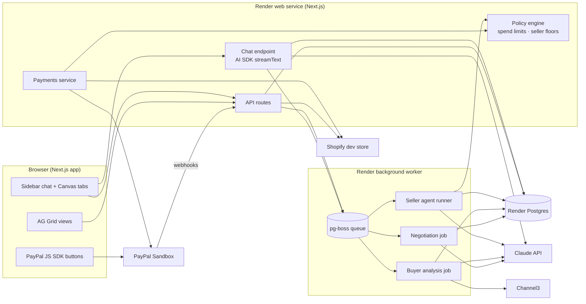
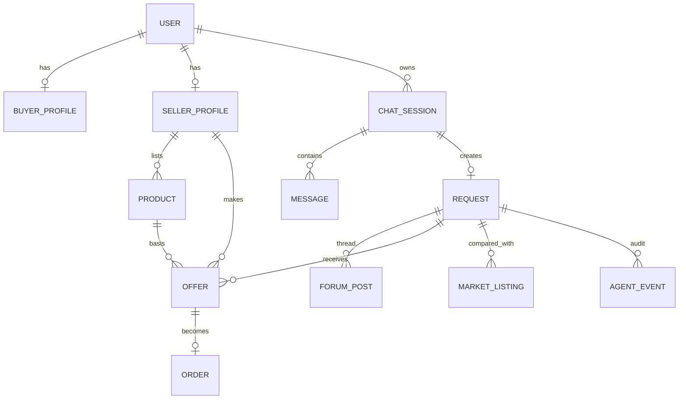
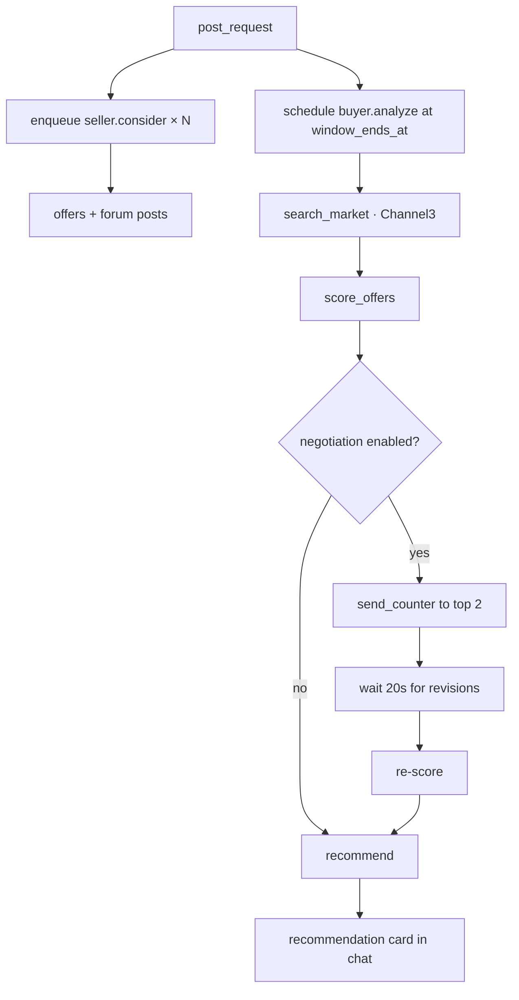

# OpenQuote — Architecture & Tech Stack

Related: [Plan](01-plan.md) · [User flow](02-user-flow.md) · [Roles & milestones](04-roles-milestones.md)

Items marked **⚠ verify** are API details to confirm against current docs during the Day-1 spikes.

---

## 1. Tech stack

| Layer | Choice | Why |
|---|---|---|
| Language | **TypeScript** everywhere | One language across the team; PayPal Agent Toolkit, Channel3 SDK and AG Grid all have first-class TS support |
| Web app | **Next.js (App Router)** + React, Tailwind, shadcn/ui | Pages and API routes in one deployable |
| Chat UI & agent runtime | **Vercel AI SDK** (`ai`, `@ai-sdk/anthropic`) | Streaming chat (`useChat`), tool calling, multi-step loops; the PayPal Agent Toolkit ships an AI SDK adapter |
| LLM | **Claude** — `claude-sonnet-5-5` for the buyer agent, `claude-haiku-5-5` for seller agents | Strong tool use and reasoning for the buyer; fast and cheap for many parallel seller agents |
| Grid | **AG Grid React** (Enterprise features: row grouping, master-detail, integrated charts) | Sponsor prize; live transaction updates |
| DB | **PostgreSQL** + **Drizzle ORM** | Relational data, JSONB for flexible specs |
| Background jobs | **pg-boss** (Postgres-backed queue) in a separate **worker** process | Seller agents and analysis run off the request path; no Redis needed |
| Live updates | Client polling (TanStack Query, 1.5s) **[P0]** → SSE **[P2]** | Polling is simple and reliable for a demo |
| Auth | **Better Auth** (email + password), `role` on user | Quick, self-hosted, no external dashboard |
| Validation | **Zod** | Shared schemas for agent protocol, tools and API |
| Payments | **PayPal REST (Orders v2, Multiparty, Partner Referrals, Vault)** + **PayPal JS SDK** buttons + **PayPal Agent Toolkit** | See §6 |
| Market data | **Channel3 SDK** (`POST /v1/search`) | Public-web comparison listings |
| Commerce | **Shopify Admin GraphQL API** (dev store) | Seller catalog import and order write-back |
| Hosting | **Render**: web service + background worker + Render Postgres | Hosted demo URL; Render prize eligibility |

---

## 2. System overview



**Key principle — the LLM proposes, the server disposes.** Agents act only through typed tools. Every tool that touches money or prices goes through the **policy engine**, which checks the stored guardrails and rejects violations. The LLM never sends amounts straight to PayPal.

---

## 3. Repository layout

```
openquote/
├─ app/                         # Next.js App Router
│  ├─ (auth)/login, signup
│  ├─ (app)/layout.tsx          # sidebar + canvas shell
│  ├─ (app)/s/[sessionId]/      # chat | forum | offers tabs
│  ├─ (app)/forum/              # global forum
│  ├─ (app)/seller/catalog, deals, settings
│  └─ api/
│     ├─ chat/route.ts          # AI SDK streaming endpoint (buyer + seller)
│     ├─ requests/, offers/, forum/
│     ├─ paypal/orders, paypal/capture, paypal/vault, paypal/onboard, paypal/webhook
│     └─ shopify/connect, shopify/import
├─ src/
│  ├─ agents/
│  │  ├─ buyer/  prompt.ts, tools.ts, analyze.ts, negotiate.ts
│  │  ├─ seller/ prompt.ts, tools.ts, run.ts, personas.ts
│  │  └─ protocol.ts            # Zod: Request, Offer, Counter, Question, Answer
│  ├─ policy/                   # spend + seller guardrail checks (pure functions, unit-tested)
│  ├─ integrations/
│  │  ├─ paypal/  client.ts (OAuth token cache), orders.ts, vault.ts, partner.ts, webhooks.ts
│  │  ├─ channel3.ts
│  │  └─ shopify.ts
│  ├─ db/ schema.ts, client.ts
│  └─ jobs/ queue.ts, handlers.ts
├─ worker/index.ts              # pg-boss worker entry
├─ components/ grid/, chat/, forum/
├─ scripts/ seed.ts             # demo sellers, products, buyer account
├─ render.yaml                  # web + worker + postgres blueprint
└─ README.md
```

---

## 4. Data model



| Table | Key columns |
|---|---|
| `user` | id, email, name, role (`buyer`/`seller`) |
| `buyer_profile` | user_id, paypal_vault_id, paypal_customer_id, auto_pay_limit, monthly_cap, spent_this_month |
| `seller_profile` | user_id, display_name, persona (seeded only), paypal_merchant_id, onboarding_status, platform_fee_enabled, shopify_domain, shopify_token (encrypted), auto_deal |
| `product` | id, seller_id, source (`chat`/`shopify`/`seed`), title, description, category, unit_price, currency, stock, moq, lead_time_days, attributes jsonb, floor_price, max_discount_pct, shopify_product_id, shopify_variant_id |
| `chat_session` | id, user_id, title, status |
| `message` | id, session_id, role, content, parts jsonb (tool calls, cards) |
| `request` | id, session_id, buyer_id, spec jsonb (see protocol), budget_max, deadline, location, status (`draft`/`open`/`analyzing`/`recommended`/`approved`/`paid`/`closed`), window_ends_at |
| `forum_post` | id, request_id, author_kind (`buyer_agent`/`seller_agent`), author_id, type (`request`/`offer`/`question`/`answer`/`counter`/`system`), body, offer_id |
| `offer` | id, request_id, seller_id, product_id, unit_price, qty, shipping, total, eta_days, warranty, terms, status (`active`/`countered`/`revised`/`won`/`lost`/`withdrawn`), version, ai_score, spec_match, flags text[], rationale |
| `market_listing` | id, request_id, source (`channel3`), title, merchant, price, url, image, raw jsonb |
| `order` | id, offer_id, buyer_id, seller_id, paypal_order_id, paypal_capture_id, amount, platform_fee, status, shopify_order_id |
| `agent_event` | id, request_id, actor, tool, input jsonb, output jsonb, policy_decision, created_at (audit trail, shown in demo) |

---

## 5. Agent design

### 5.1 Agent protocol (`src/agents/protocol.ts`)

All forum traffic is **typed**; the human-readable `body` is generated alongside. This replaces "scraping": the buyer agent reads structured offers directly.

```ts
RequestSpec = {
  item: string; category?: string;
  quantity: number; unit?: string;
  budgetMax: number; currency: "USD";
  deadline: string;          // ISO date
  location: string;
  mustHave: string[]; niceToHave: string[];
}

Offer = {
  requestId; productId;
  unitPrice: number; quantity: number; shipping: number; total: number;
  etaDays: number; warranty?: string; returnPolicy?: string;
  terms?: string; pitch: string;          // pitch = forum text
}

Counter  = { offerId; targetUnitPrice?: number; targetEtaDays?: number; message: string }
Question = { requestId; question: string }   // seller → buyer agent
Answer   = { questionPostId; answer: string; escalated: boolean }
```

### 5.2 Buyer agent

Runs in the chat endpoint (interactive) and in worker jobs (background analysis and negotiation).

| Tool | Purpose | Guarded by |
|---|---|---|
| `update_request_draft(spec)` | Fill slots while clarifying | Zod |
| `post_request(requestId)` | Publish to forum, schedule `analyze` job at `window_ends_at` | User confirmed in UI |
| `answer_seller_question(postId, answer)` | Reply from known spec, or `escalate` to user | — |
| `search_market(query, filters)` | Channel3 search → `market_listing` | Rate-limited, cached per request |
| `score_offers(requestId)` | Writes ai_score, spec_match, flags, rationale | — |
| `send_counter(offerId, counter)` | Negotiation, max 1 round **[P1]** | Policy: only below budget |
| `recommend(requestId, offerIds[3])` | Emits recommendation card | — |
| `pay_for_offer(offerId)` | Charge saved PayPal / create order for popup | **Policy engine** (see §6.4) |

**Scoring.** The LLM produces spec_match, flags and rationale; the **final score is computed in code** so it's explainable and stable:
`score = 0.40·priceScore + 0.25·deadlineFit + 0.20·specMatch + 0.15·sellerTrust − penalties(flags)`
priceScore is relative to the best forum offer *and* the Channel3 median, which is where the "$X cheaper than the public web" line comes from.

**Flags (rules + LLM):** price < 50% of market median, missing return policy, ETA after deadline, quantity below requested, seller payment setup pending.

### 5.3 Seller agents

One runner executes every seller agent. Seeded agents differ by **persona** (prompt + guardrail settings); real sellers use their own catalog and guardrails.

Trigger: `request.posted` → enqueue one `seller.consider` job per seller with active products.

1. **Match:** an LLM call over the request spec plus a compact catalog summary → `{relevant, productId, confidence}`. Skip below threshold. *(P2: pgvector prefilter.)*
2. **Price:** code computes allowed range `[floor, list]`; LLM picks within range given persona and request budget.
3. **Post:** `make_offer(offer)` → policy validates (≥ floor, ≤ stock, qty cap) → insert offer + forum post.
4. **Respond:** on `counter` → `respond_to_counter` (accept / revise within guardrails / decline).
5. Random 2–15s delay per seeded agent so the forum fills naturally on video.

**Seeded personas (demo):**
| Seller | Persona | Purpose in demo |
|---|---|---|
| EcoCup Co. | Mid price, fast, good warranty | Likely winner |
| PrintPal Studio | Premium, fastest, custom design help | Premium alternative |
| BulkBarn | Cheapest, slow (misses deadline) | Shows deadline scoring |
| HaggleHouse | High opening price, negotiates down | Shows negotiation |
| DealzNow | Suspiciously cheap, vague terms | Shows risk flag |
| LocalKL Packaging | Local, asks a clarifying question | Shows agent Q&A |

### 5.4 Job flow



---

## 6. PayPal integration

### 6.1 Account setup (sandbox)
- Developer Dashboard → sandbox → create a **Platform REST app** for the platform (Multiparty). PayPal docs: sandbox testing is allowed before partner approval.
- Sandbox accounts: 1 platform business account (API caller), 6 seller business accounts (one per seeded persona), 2 buyer personal accounts with balance.
- Send the `PayPal-Partner-Attribution-Id` (BN code) header on Multiparty calls. **⚠ verify** the sandbox BN code value.

### 6.2 Seller onboarding
- **P0:** seeded sellers store their sandbox `merchant_id` directly.
- **P1:** `POST /v2/customer/partner-referrals` with `operations: API_INTEGRATION`, products `EXPRESS_CHECKOUT`, features `PAYMENT`, `REFUND`, `PARTNER_FEE` → `action_url` → seller completes → return URL carries `merchantIdInPayPal` → confirm with `GET /v1/customer/partners/{partner_id}/merchant-integrations/{merchant_id}` (`payments_receivable`, `primary_email_confirmed`). Webhook `MERCHANT.ONBOARDING.COMPLETED`.

### 6.3 Paying a seller (Orders v2)
```jsonc
POST /v2/checkout/orders
{
  "intent": "CAPTURE",
  "purchase_units": [{
    "reference_id": "<offerId>",
    "amount": { "currency_code": "USD", "value": "360.00" },
    "payee": { "merchant_id": "<seller merchant id>" },
    "payment_instruction": {                         // P1
      "platform_fees": [{ "amount": { "currency_code": "USD", "value": "10.80" } }]
    }
  }],
  "payment_source": { "paypal": { /* see 6.4 */ } }
}
```
- **P0 (buyer present):** JS SDK button → `createOrder` calls our API → buyer approves in the popup → `onApprove` → our API captures.
- Platform fee: 3% default. If the fee isn't accepted in the sandbox for a seller, omit it and log it (fee shown as "simulated").

### 6.4 Agent auto-pay (saved PayPal) [P1]
1. **Save once (buyer present):** a PayPal button flow with `payment_source.paypal.attributes.vault = { store_in_vault: "ON_SUCCESS", usage_type: "PLATFORM" }` (or setup tokens via Vault v3 to save without a purchase). Store the returned vault id on `buyer_profile`. **⚠ verify** field names and whether `PLATFORM` usage is enabled for sandbox platform apps.
2. **Charge later (buyer not present):** `payment_source.paypal.vault_id = <id>` on a new order, payee = seller → capture.
3. **Policy engine check before any call:**
   - offer is `won`/selected and belongs to this request
   - amount == offer.total (recomputed server-side)
   - amount ≤ auto_pay_limit and spent_this_month + amount ≤ monthly_cap, **or** an explicit user approval record exists for this offer + amount
   - seller `payments_receivable`
   - idempotency key = offerId (no double charge)
4. **Fallback** (vault blocked in sandbox): the same policy check, then the popup flow from 6.3. The UX copy changes from "Agent paid" to "Approve in PayPal".

### 6.5 Agent Toolkit
- Use `@paypal/agent-toolkit` (AI SDK adapter, `context: { sandbox: true }`) for **read and support tools** the buyer agent can call directly: get order status, and order tracking if supported. **⚠ verify** the current import path and tool names in the GitHub README.
- Money-moving calls (create/capture with Multiparty payee, vault, fees) go through our own `payments` service, because they need the policy engine and Multiparty fields the toolkit may not expose.

### 6.6 Webhooks
`PAYMENT.CAPTURE.COMPLETED`, `PAYMENT.CAPTURE.DENIED`, `MERCHANT.ONBOARDING.COMPLETED`, `MERCHANT.PARTNER-CONSENT.REVOKED` → verify the signature → update `order` / `seller_profile`. Capture responses also update state synchronously, so the demo doesn't depend on webhook latency.

---

## 7. Channel3
- `POST /v1/search` with the request item + key attributes; filters on price where useful. Auth header `x-api-key` (SDK reads `CHANNEL3_API_KEY`).
- Store the top 5–8 results as `market_listing`, cache by query hash.
- **P1 seller use:** when a chat-registered product lacks details or an image, look up similar products to enrich it.
- Normalise retail unit prices against bulk quantity so the grid comparison is fair (show "est. total for 500").

## 8. Shopify [P1]
- Create a dev store via Shopify Partners; create an app and install it to get an **Admin API access token** with `read_products`, `read_inventory`, `write_orders`. **⚠ verify** the current app-creation flow (Dev Dashboard vs legacy custom apps).
- **Import:** GraphQL `products(first: 50) { title, description, variants { id price inventoryQuantity } }` → `product` rows (source `shopify`).
- **Order write-back:** `orderCreate` (or `draftOrderCreate` + complete) with the variant + quantity, marked paid with a note containing the PayPal order ID.
- Token stored encrypted (AES-GCM with an env key).

## 9. AG Grid usage (for the AG Grid prize)
| Feature | Where |
|---|---|
| Live row updates (`applyTransactionAsync`) with flash on change | Offers grid as offers arrive and prices drop after counters |
| Row grouping by Source (Forum vs Public web) | Offers grid |
| Custom cell renderers: score bar, flag chips, deadline ✓/✗, seller avatar | Offers grid |
| Pinned top row = recommended offer | Offers grid |
| Master-detail: offer thread + AI rationale | Offers grid **[P1]** |
| Integrated chart: price vs ETA scatter | Offers grid **[P1]** |
| Editable cells for guardrails (floor price, max discount, stock) | Seller catalog grid |
| Status pipeline and set filters | Seller deals grid |
| Theme matched to app (Quartz theme, dark mode) | All |

---

## 10. Security & reliability (hackathon-appropriate)
- Secrets only in env vars (Render); `.env.example` in repo.
- PayPal OAuth token cached server-side; never exposed to client.
- Auth check on every API route; sellers only see their own deals; buyers never see other buyers' requests' private fields (location is shown as city only).
- Prompt-injection hygiene: seller pitches are **untrusted text** to the buyer agent. The system prompt says so, tools can't be triggered by offer text, and payments need the policy check plus user approval.
- Idempotency keys on order creation (`PayPal-Request-Id` = offerId).
- LLM failures: retry once, then post a system message; the demo seed path works without LLM calls if needed (scripted fallback offers).

## 11. Environment variables
```
DATABASE_URL=
BETTER_AUTH_SECRET=
ANTHROPIC_API_KEY=
PAYPAL_CLIENT_ID=
PAYPAL_CLIENT_SECRET=
PAYPAL_PARTNER_MERCHANT_ID=
PAYPAL_BN_CODE=
PAYPAL_WEBHOOK_ID=
NEXT_PUBLIC_PAYPAL_CLIENT_ID=
CHANNEL3_API_KEY=
SHOPIFY_TOKEN_ENC_KEY=
AG_GRID_LICENSE_KEY=        # optional
APP_URL=
```

## 12. Testing
- **Unit (Vitest):** policy engine (limits, floors, idempotency), scoring formula, protocol schemas, Channel3 price normalisation.
- **Integration:** PayPal sandbox scripts (`scripts/paypal-smoke.ts`): create → approve (sandbox buyer) → capture with payee; vault save + charge.
- **E2E smoke (Playwright, P1):** buyer signup → request → seeded offers appear → approve → order recorded.
- **Demo rehearsal:** a `scripts/reset-demo.ts` that clears requests and re-seeds, run before every recording.
